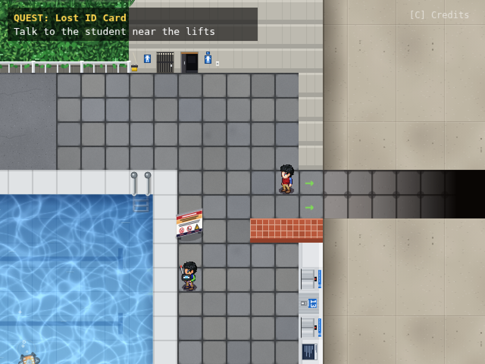
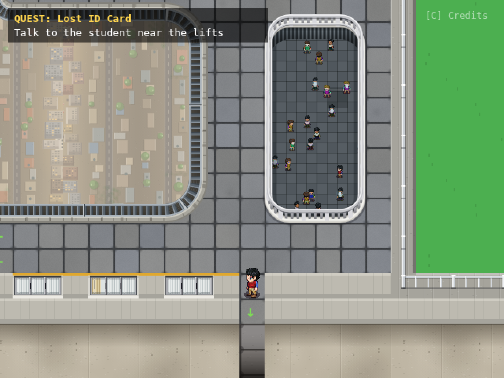

# Credit Hours

An episodic top-down 2D pixel-art game series set on a lovingly rebuilt university rooftop. Each episode is its own self-contained story, released one at a time. **Episode 1: *Deadline*** (working title) is in development. The current build is the playable rooftop prototype: no combat, no monsters, just wandering around, chatting with students, peeking over the rails at the city, and poking at everything you can find.

> **Status:** work in progress (Episode 1: *Deadline* is in development). Three connected zones, a handful of NPCs, one quest and a lot of small interactions. The lower floor is still under construction.

<p align="center">
  
  
</p>
<p align="center"><em>The Pool Zone (left) and the Lawn Zone (right).</em></p>

## The story so far

You ride the escalator up to the rooftop as the screen fades in from black. A student named Tanvir, standing by the lifts, has lost his ID card. Find it in the open area by the south railing and bring it back.

After that, the roof is yours: climb down into the Robotics Lab's test tank, sit on a bench, lean out over a railing at golden hour, or try the wrong restroom door and regret it.

## The zones

| Zone | What's there |
|---|---|
| **Rooftop Entry** | Where you arrive. An amphitheatre with railed stair flights, the escalator well (look down and see the floors below), lifts, a glass skylight with students walking on the floor underneath, planted hedge beds, benches, water filters, the gym facade and a storage room. |
| **Pool Zone** | The Robotics Lab's test tank (it is *not* a swimming pool) with little ROVs drifting around, a "RESTRICTED AREA" signboard, two lab members steering the robots, the restrooms, and bench rings under the trees. |
| **Lawn Zone** | A big fenced lawn ringed by wide paths, bench areas, railed holes you can look down through to the floor below, bins and floor vents, two flights of steps up to the lawn, and the **big stairs down** to the lower floor (coming soon). |

Zones are linked by paths and stairs. Walking onto an exit fades the screen to black, swaps the zone, and fades back in.

## Features

**Exploring**
- **Opening cutscene:** an animated escalator ride that fades in from black (press `E` or `Space` to skip)
- **Three connected zones** with fade transitions. The heavy pictures of each zone are painted behind the black screen, so entering a new area doesn't stutter, even on phones
- **Smooth movement:** 4-direction walking with a sprite walk cycle, using delta time so speed is the same on every monitor. Stairs slow you down, and you visibly sink and dim as you head down the big stairs
- **Foot-only collision:** only a strip under your shoes collides, so you can stand right at the foot of anything. Rails, holes, curved rails and the escalator nose use their exact drawn shape, and you slide along walls instead of getting stuck
- **Follow camera** that centres on you and stops at the map edges

**The world**
- **Skyline view:** rails on the edge of a zone reveal the city beyond. It is hazy from a distance and clearer as you get close, with a different view on each side. Press `E` at a rail to **lean out** for the clearest view
- **Living hedges:** the planted beds are generated from noise, blending sparse planter grass and monstera leaves with dense ivy. Leaves spill over the rails and vines hang over the edge of the building
- **Life below:** through the skylight, the holes and the escalator well you can see people on the lower floors walking, checking phones and standing in gossip circles
- **Animated water:** the test tank has caustic light, ripples, glints and swimming ROVs that turn on their own when they sense a wall
- **Almost everything is painted in code:** floors, hedges, water, glass, railings and the skyline are drawn by the game itself. Only the characters use spritesheets

**Things to do**
- **Quest:** a small state machine with an on-screen tracker (talk to Tanvir, find the ID card, return it)
- **NPCs with dialogue:** students turn to face you, and the lab members have different lines on repeat visits
- **Sit** on benches
- **Drink** from the water filters
- **Read** the pool signboard up close
- **Swim** in the test tank. The steel ladder is the only way in or out
- **Visit the restrooms:** the men's is a short fade-to-black scene with typewriter text, the women's... isn't, and gets more exasperated each time you try
- **Lean out** over any rail

**Quality of life**
- **Mobile touch controls** with a thumb stick and an **E** button, plus tap-to-advance dialogue
- **In-game credits screen** (press `C`)
- **Debug mode** (`F3`) shows the tile grid, solid tiles and collision boxes

## Controls

| Key | Action |
|---|---|
| `W` `A` `S` `D` / Arrow keys | Move |
| `E` | Talk, advance dialogue, sit / stand, drink, read the sign, use a restroom, climb the pool ladder, lean out at a rail |
| `E` / `Space` | Skip the intro, advance restroom text |
| `C` | Show or hide credits |
| `F3` | Toggle debug view |

A hint like `[E] Sit down` appears whenever there is something to interact with.

**On a phone or tablet** the controls appear automatically: a thumb stick on the left (walk) and an **E** button on the right. Tap `[C] Credits` to open the credits, and tap a text box to advance it. Landscape gives the biggest view.

## Running the game

The game uses ES modules, which browsers block when you open `index.html` directly from disk. Use a local server:

```bash
cd credit-hours
python -m http.server 8000      # on Windows you can also use: py -m http.server 8000
```

Then open **http://localhost:8000** in your browser.

Other options: `npx serve`, or the *Live Server* extension in VS Code. After editing code, hard-refresh with `Ctrl + Shift + R` to bypass the cache.

## Tech

- HTML5 Canvas 2D with a `requestAnimationFrame` game loop
- Vanilla JavaScript (ES modules), around 7,000 lines
- Static pictures (floor slabs, hedges, skyline panoramas, stairs, escalator frames) are painted once into offscreen canvases and stamped each frame; only moving things are redrawn
- A warm-up queue paints each zone's heavy pictures a few milliseconds per frame behind the black screen
- Procedural, deterministic art: noise and hashes of world position mean the picture is identical on every run and neighbouring tiles line up
- No frameworks, engines, libraries or build tools

## Project structure

```
credit-hours/
├── index.html
├── CREDITS.md
├── LICENSE
├── assets/
│   ├── character-spritesheet.png   player sprites
│   ├── npc-spritesheet.png         NPC sprites
│   ├── character-credits.txt       per-layer art credits (player)
│   └── npc-credits.txt             per-layer art credits (NPC)
├── docs/                           README screenshots
└── js/
    ├── main.js        game loop, interaction wiring
    ├── zones.js       ALL zone maps, exits, holes, rails, fences and props
    ├── map.js         zone loading, tile queries, collision, pool props
    ├── player.js      movement, stairs, swimming, sitting, foot collision
    ├── npc.js         the student NPC: talk range, facing
    ├── dialogue.js    dialogue box state
    ├── quest.js       quest state machine and NPC lines
    ├── intro.js       escalator opening cutscene
    ├── transition.js  fade out, swap zone, fade in
    ├── warmup.js      paints a zone's heavy pictures behind the black screen
    ├── input.js       keyboard + touch input (thumb stick, E button, taps)
    ├── display.js     canvas sizing (whole-pixel scaling, phones)
    ├── sprites.js     spritesheet loading, recoloured student variants
    ├── renderer.js    all tile drawing, camera, HUD, debug view, credits screen
    ├── floor.js       stone paving
    ├── foliage.js     hedges, ivy, vines
    ├── canopy.js      bush mounds and tree crowns
    ├── skyline.js     the city beyond the rails, fog, lean out, exit paths
    ├── curverail.js   smooth curved and rounded-corner railings
    ├── nose.js        the escalator rail's rounded nose (collision shape)
    ├── escalator.js   the escalator well and the cutscene ride path
    ├── glass.js       the skylight and the crowd on the floor below
    ├── glassdoor.js   glass room doors on the west wall
    ├── hole.js        railed openings you can look down through
    ├── stairwell.js   the big stairs down (lower floor coming soon)
    ├── pool.js        test tank water, ROVs, signboard, lab members, ladder
    └── restroom.js    the restroom scenes
```

### Editing the maps

All maps live in **`js/zones.js`** as grids of characters. Every row of a zone must be the same length. The comment block at the top of that file is the full tile legend; the most common tiles are:

| Char | Tile |
|---|---|
| `#` / `R` | Wall / railing (with the skyline beyond) |
| `.` | Stone floor |
| `g` | Lawn grass |
| `H` `Y` `Z` | Hedge, bush mound, tree (solid, with a guard rail) |
| `C` `T` | Bench, tree planter (bench ring) |
| `~` / `B` | Water / pool rim |
| `W` | Glass skylight |
| `1`-`8` | Amphitheatre tiers |
| `S` / `u` / `n` | Stairs |
| `E` `F` `v` | Escalator belts and well |
| `L` `l` `f` `d` `A` | Lift area: pillar, door, wall strip, directory, level sign |
| `M` `G` | Men's / women's restroom doors |
| `J` `Q` `r` | Gym sliding door, poster wall, red mat |
| `X` `U` | Exit paths |

Zone-wide extras (holes, curved rails, fences, props, stairwells, exits) are defined as data next to each zone's grid.

An exit looks like this:

```js
'30,10': { to: 'zone1', spawn: { x: 1, y: 10 }, facing: 'right', label: 'Right path' }
```

The key is the exit tile, `to` is the zone to fade into, and `spawn` is where the player arrives (never on an exit tile).

## Roadmap

- [x] More zones: entry, pool and lawn
- [x] NPC collision and more NPCs
- [x] Mobile touch controls
- [x] Skyline, lean out, and life on the floors below
- [x] Interactions: sit, drink, swim, restrooms, signboard
- [ ] The lower floor, down the big stairs
- [ ] Locked gym door and follow-up quests
- [ ] More NPCs and quests tied to the Robotics Lab
- [ ] Sound effects and music
- [ ] Save and load progress
- [ ] Title screen, menu and episode select
- [ ] Episode 1: *Deadline*
- [x] Fill in the character credits from the generator (`assets/character-credits.txt`, `assets/npc-credits.txt`)

## Credits

Character sprites were made with the **Universal LPC Spritesheet Character Generator**, using art from the Liberated Pixel Cup project on OpenGameArt.org. These assets are licensed under CC-BY-SA / GPL and require attribution. See [`CREDITS.md`](CREDITS.md), [`assets/character-credits.txt`](assets/character-credits.txt) (player) and [`assets/npc-credits.txt`](assets/npc-credits.txt) (NPC) for the full list of authors and licenses.

The rooftop is inspired by a real university rooftop.

## License

- **Code:** MIT License
- **Character art:** CC-BY-SA 3.0 (with GPL 3.0 / OGA-BY 3.0 layers), see [`CREDITS.md`](CREDITS.md)

## Authors

Built by Md. Fahim Hassan & Shahriar Islam Tawsif, CSE students, as a passion project.